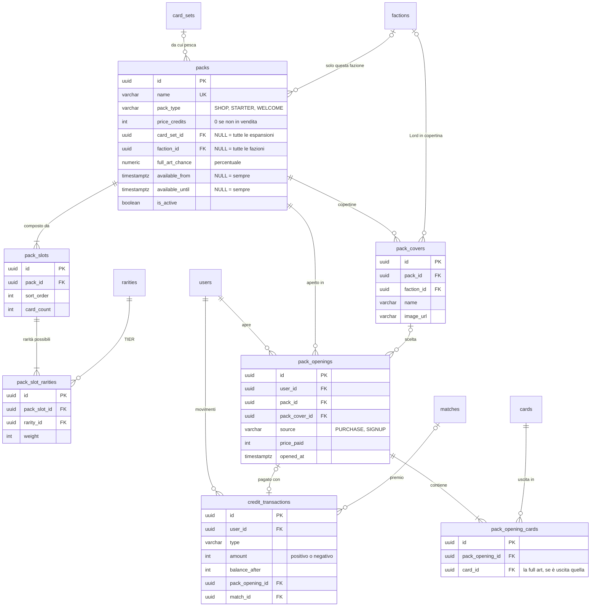
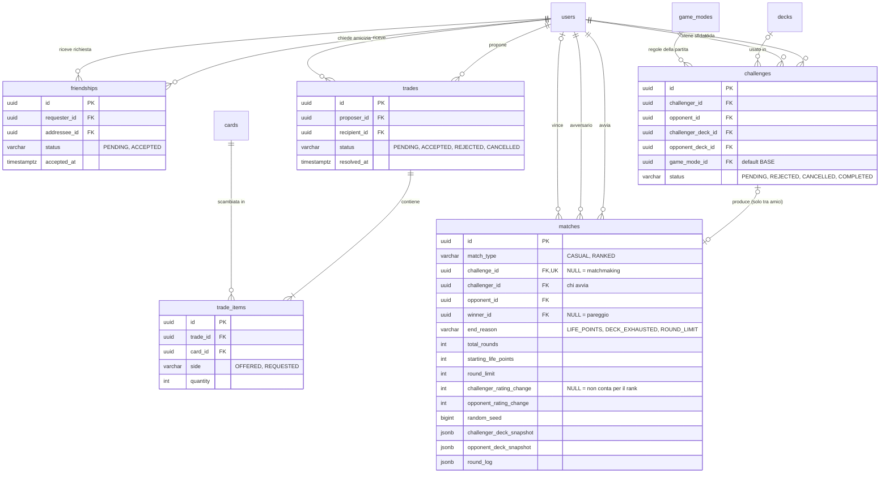
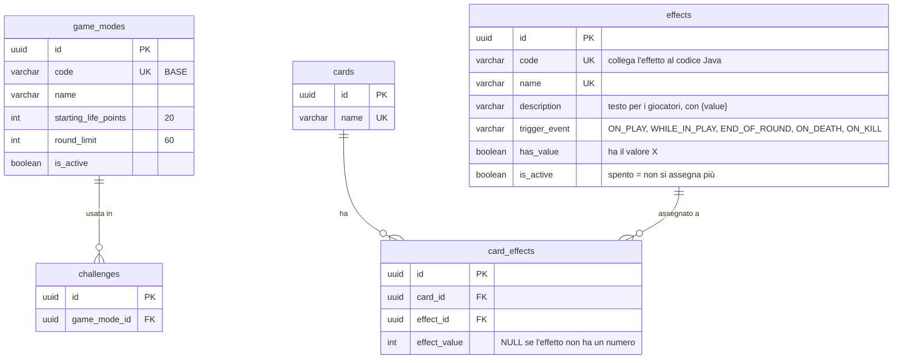
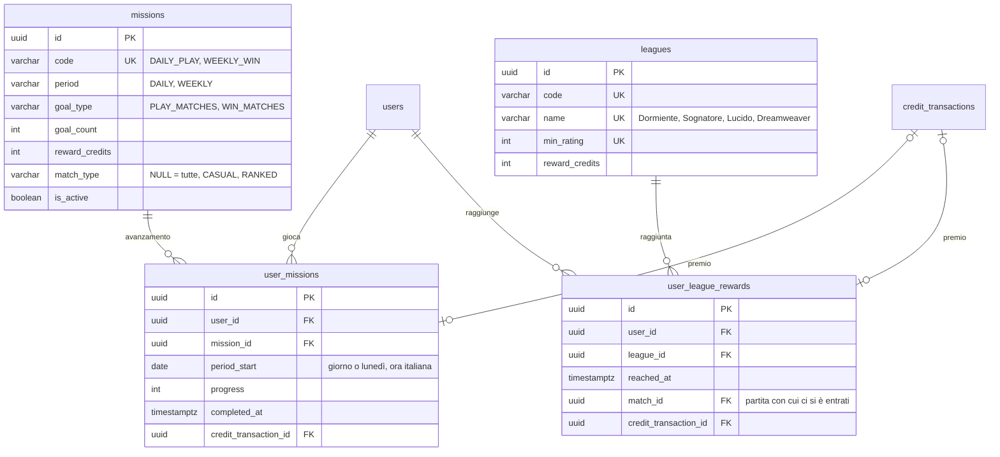

# Proposta di schema del database · Dreamscape

> 🚧 **Proposta da verificare, non ancora approvata.** Lo schema segue il [brief](#requisiti-del-brief-coperti), la [proposta di regolamento](../proposte/proposta-regolamento-dreamscape.pdf) e le convenzioni di [naming.md](../naming.md). Diventa definitivo solo dopo la revisione del team SWD: fino ad allora tabelle, colonne e nomi possono cambiare.

- **DBMS:** PostgreSQL 18 o successivo
- **Chiavi:** UUID v7 su tutte le tabelle, generati dal database con `uuidv7()`
- **Accesso:** token JWT; i refresh token si salvano in `refresh_tokens`
- **Migration:** Flyway
- **SQL completo:** [schema.sql](schema.sql), già diviso nelle future migration
- **Gioco:** Dreamscape, a tema sogni, del gruppo Somnia. Fazioni, vantaggi, rarità e Lord stanno in tabella: si ribilanciano cambiando i dati, non lo schema.

## Indice

1. [Tabelle in breve](#tabelle-in-breve)
2. [Diagrammi ER](#diagrammi-er)
3. [Scelte principali](#scelte-principali)
4. [Regole che il database non controlla](#regole-che-il-database-non-controlla)
5. [Formato dei campi JSON di `matches`](#formato-dei-campi-json-di-matches)
6. [Migration Flyway](#migration-flyway)
7. [Dati del catalogo ed espansioni](#dati-del-catalogo-ed-espansioni)
8. [Punti aperti](#punti-aperti)
9. [Requisiti del brief coperti](#requisiti-del-brief-coperti)
10. [Pagine del portale e tabelle](#pagine-del-portale-e-tabelle)
11. [Cosa è cambiato in questa versione](#cosa-è-cambiato-in-questa-versione)

---

## Tabelle in breve

| Area | Tabella | Contenuto |
|------|---------|-----------|
| Utenti e accesso | `users` | Giocatori e admin (`role`), saldo crediti, punteggio di rank, fazione del set iniziale, mazzo classificato, consensi Privacy e Termini |
| | `refresh_tokens` | Refresh token per l'accesso con JWT (salvati come hash) |
| | `password_reset_tokens` | Token per il recupero password |
| Catalogo carte | `factions` | Le fazioni, con il titolo e la carta del loro Lord |
| | `faction_advantages` | Chi è forte contro chi e con che bonus |
| | `rarities` | I TIER di rarità, con il limite per mazzo e le copie massime |
| | `card_sets` | Le espansioni: set base, espansione 1... |
| | `cards` | Le carte-creatura con codice, ATT, DIF, fazione, rarità, espansione, illustrazioni e ritaglio |
| Collezione e mazzi | `user_cards` | Le carte possedute da ogni utente, con il numero di copie (la full art è una carta a parte) |
| | `decks` | I mazzi degli utenti |
| | `deck_cards` | Le carte di ogni mazzo |
| Pacchetti | `packs` | I pacchetti: in vendita (anche di una fazione o a tempo), set iniziale, benvenuto |
| | `pack_covers` | Le copertine di un pacchetto (es. una per ogni Lord) |
| | `pack_slots` | Gli slot di un pacchetto e quante carte dà ciascuno |
| | `pack_slot_rarities` | Le rarità possibili in ogni slot, con il loro peso |
| | `pack_openings` | Ogni apertura di un pacchetto, comprato o regalato |
| | `pack_opening_cards` | Le carte uscite da ogni apertura |
| Amici e scambi | `friendships` | La lista amici: richieste in attesa e amicizie accettate |
| | `trades` | Le proposte di scambio tra amici e il loro stato |
| | `trade_items` | Le carte offerte e richieste in ogni scambio |
| Sfide e partite | `challenges` | Le sfide tra amici (partite rapide) e il loro stato |
| | `matches` | Il risultato della partita simulata, rapida o classificata, round per round |
| Crediti | `credit_transactions` | Ogni movimento di crediti, con il motivo |
| Missioni e leghe | `missions` | Missione giornaliera e obiettivo settimanale, con il premio |
| | `user_missions` | L'avanzamento di ogni giocatore nelle missioni, per giorno o settimana |
| | `leagues` | Le leghe del rank, con il punteggio minimo e il premio |
| | `user_league_rewards` | Le leghe raggiunte da ogni giocatore, per dare il premio una volta sola |
| Modalità ed effetti | `game_modes` | Le modalità di gioco con i loro valori (punti vita, limite di round) |
| | `effects` | Il catalogo degli effetti (provvisorio, [decisione 028](../decisioni/028-catalogo-degli-effetti.md)), validi in ogni partita |
| | `card_effects` | Quali effetti ha ogni carta, con il loro valore |
| Contatti | `contact_messages` | I messaggi inviati dal form della pagina Contatti |

---

## Diagrammi ER

Per leggibilità i diagrammi sono divisi per area. Le colonne complete sono in [schema.sql](schema.sql).

### Utenti, catalogo, collezione e mazzi

```mermaid
erDiagram
    users ||--o{ refresh_tokens : "ha"
    users ||--o{ password_reset_tokens : "ha"
    users ||--o{ user_cards : "possiede"
    users ||--o{ decks : "crea"
    users |o--o{ contact_messages : "scrive"
    cards ||--o{ user_cards : "posseduta in"
    decks ||--|{ deck_cards : "contiene"
    cards ||--o{ deck_cards : "usata in"
    cards |o--o{ cards : "versione (full art)"
    factions ||--o{ cards : "raggruppa"
    factions |o--o| cards : "Lord"
    rarities ||--o{ cards : "classifica"
    card_sets ||--o{ cards : "contiene"
    factions ||--o{ faction_advantages : "forte contro"
    factions ||--o{ faction_advantages : "debole contro"
    factions |o--o{ users : "set iniziale"
    decks |o--o| users : "mazzo classificato"

    users {
        uuid id PK
        varchar username UK
        varchar email UK
        varchar password_hash
        varchar role "PLAYER, ADMIN"
        int credits "saldo, mai negativo"
        int rating "rank, parte da 1000"
        uuid starter_faction_id FK "NULL finché non sceglie"
        uuid ranked_deck_id FK "mazzo classificato"
        date last_daily_reward_on
        boolean is_enabled
        timestamptz privacy_accepted_at
        timestamptz terms_accepted_at
    }
    contact_messages {
        uuid id PK
        uuid user_id FK "NULL = visitatore"
        varchar name
        varchar email
        text message
        varchar status "NEW, READ, ARCHIVED"
    }
    refresh_tokens {
        uuid id PK
        uuid user_id FK
        char token_hash UK
        timestamptz expires_at
        timestamptz revoked_at
    }
    password_reset_tokens {
        uuid id PK
        uuid user_id FK
        char token_hash UK
        timestamptz expires_at
        timestamptz used_at
    }
    factions {
        uuid id PK
        varchar code UK
        varchar name UK
        varchar lord_title "es. Dreams Lord"
        uuid lord_card_id FK, UK
    }
    faction_advantages {
        uuid id PK
        uuid faction_id FK "fazione forte"
        uuid target_faction_id FK "fazione debole"
        int attack_bonus
        int defense_bonus
    }
    rarities {
        uuid id PK
        varchar code UK
        int sort_order UK
        int max_per_deck "NULL = nessun limite"
        int max_copies "copie della stessa carta"
    }
    card_sets {
        uuid id PK
        varchar code UK "BASE, EXP1, ..."
        varchar name UK
        date released_at
        boolean is_active
    }
    cards {
        uuid id PK
        varchar code UK "es. BASE-001, BASE-004-FA"
        uuid base_card_id FK "NULL = carta normale"
        varchar variant_type "NULL, FULL_ART"
        varchar name UK "NULL nelle versioni"
        int attack "almeno 1; NULL nelle versioni"
        int defense "almeno 1; NULL nelle versioni"
        uuid faction_id FK "NULL nelle versioni"
        uuid rarity_id FK "NULL nelle versioni"
        uuid card_set_id FK
        varchar illustration_url "3:2, o 2:3 per la full art"
        varchar illustration_thumb_url "miniatura"
        numeric illustration_focus_y "ritaglio"
        boolean is_active
    }
    user_cards {
        uuid id PK
        uuid user_id FK
        uuid card_id FK
        int quantity
    }
    decks {
        uuid id PK
        uuid user_id FK
        varchar name
    }
    deck_cards {
        uuid id PK
        uuid deck_id FK
        uuid card_id FK
        int quantity
    }
```



### Pacchetti e crediti



### Scambi e sfide



### Modalità di gioco ed effetti



### Missioni e leghe



---

## Scelte principali

### Utenti e crediti

| Scelta | Perché |
|--------|--------|
| **Ruolo come colonna** (`users.role`) invece di una tabella dei ruoli | Ci sono solo due ruoli, PLAYER e ADMIN. Con Spring si mappa con `@Enumerated(EnumType.STRING)`. |
| **Saldo in `users.credits` + registro in `credit_transactions`** | Il saldo si legge subito senza calcoli. Il registro spiega ogni movimento e serve al marketing per le stime di redditività richieste dal brief. |
| **Crediti come `INT`**, mai decimali | I crediti sono unità intere. Niente errori di arrotondamento. |
| **Punteggio di rank** (`users.rating`, `matches.*_rating_change`) | Il rank fa parte della fase 1: il matchmaking delle partite classificate abbina giocatori con punteggio simile. Elo con K = 32, si parte da 1000. La lega attuale (Dormiente, Sognatore, Lucido, Dreamweaver) si calcola dal punteggio con la tabella `leagues`. |
| **Fazione del set iniziale in `users`** (`starter_faction_id`) | Il giocatore la sceglie una volta sola nella pagina Benvenuto. Finché è `NULL` la pagina mostra la scelta; quando è valorizzata set iniziale e benvenuto sono già stati dati, quindi non si ricevono due volte. |
| **Mazzo classificato in `users`** (`ranked_deck_id`) | Il matchmaking sceglie avversari anche non collegati: serve sapere con quale mazzo giocano. Se il mazzo si cancella la colonna diventa `NULL` e il giocatore non viene più scelto finché non ne indica un altro. |
| **Ricompensa giornaliera con una colonna** (`users.last_daily_reward_on`) | Un `UPDATE ... WHERE last_daily_reward_on < :oggi` atomico dà la ricompensa una volta sola anche con due richieste nello stesso momento. Il giorno inizia a mezzanotte, ora italiana. |
| **Consensi alla registrazione** (`privacy_accepted_at`, `terms_accepted_at`) | La registrazione ha la checkbox di Privacy Policy e Termini di servizio: si salva quando sono stati accettati. Un `CHECK` li rende obbligatori per i giocatori; l'admin, creato all'avvio, non passa dalla registrazione. |
| **Messaggi dei contatti in tabella** (`contact_messages`) | Il form della pagina Contatti salva il messaggio e l'admin lo legge nel backoffice. Non serve configurare l'invio di email. |
| **Accesso con token JWT** (`refresh_tokens`) | Il token di accesso dura poco e non si salva. Il refresh token serve a ottenerne uno nuovo: si salva come hash e si revoca al logout (`revoked_at`). Il frontend in HTML/CSS/JavaScript manda il token nell'header `Authorization`. |
| **Username ed email senza distinguere maiuscole** (indici `UNIQUE` su `LOWER()`) | "Marco" e "marco" sono lo stesso utente. In PostgreSQL si ottiene con un indice sull'espressione, senza colonne in più. |
| **Utenti si disattivano, non si cancellano** (`is_enabled`) | Lo storico di sfide e scambi resta completo. Per questo le chiavi esterne di `trades` e `challenges` verso `users` non hanno `ON DELETE CASCADE`. |

### Catalogo delle carte

| Scelta | Perché |
|--------|--------|
| **Fazioni e vantaggi in tabella** | Si cambiano dal database senza toccare il codice. Regolamento attuale: ciclo Dreams → Memories → Nightmares → Dreams con +1 attacco. `defense_bonus` resta disponibile se servisse. |
| **Lord di fazione** (`factions.lord_title`, `factions.lord_card_id`) | Ogni fazione è rappresentata da una sua Leggendaria: Dreams Lord, Nightmares Lord, Memories Lord. Sono solo titolo e immagine (pagina della fazione, copertine dei pacchetti), senza regole di gioco in più. |
| **Limiti per TIER in `rarities`**: `max_per_deck` e `max_copies` | Il regolamento ha limiti per rarità (Leggendarie 2, Epiche 4, Rare 8, Comuni libere) e copie che dipendono dalla rarità (2, ma 1 per le Leggendarie). Stando in tabella si ribilanciano senza toccare il codice. |
| **Codice stabile per ogni carta** (`cards.code`, es. `BASE-001`) | Le migration con i dati e i nomi dei file immagine usano il codice, che non cambia se si corregge il nome della carta. |
| **La carta la monta il frontend** con un componente React (`Card`, #81), usato nelle pagine HTML | Il componente riceve i dati della carta e l'illustrazione e monta: illustrazione con il suo ritaglio, cornice della fazione e della rarità con la finestra trasparente, simbolo, nome, testi, ATT e DIF. Se cambia una statistica o un testo, la carta si aggiorna da sola: nessuna immagine da ricomporre. Le 15 carte del set di prova sono il riferimento visivo. |
| **Nel database solo illustrazione e ritaglio** (`illustration_url`, `illustration_thumb_url`, `illustration_focus_y`, per ogni carta e ogni versione) | L'illustrazione è l'unica parte diversa per ogni carta. Cornici, simboli, coordinate delle zone e font sono uguali per tutte e stanno nel frontend. Il ritaglio lo fa il JavaScript, ma solo il database sa dove sta il soggetto di ogni immagine: per questo il numero è nella carta (0,40 per quasi tutte, 0,27 per Il Sogno Lucido). Il ritaglio è lo stesso del compositore: niente zoom, solo spostamento verticale. |
| **Originali intatti, al browser copie WebP** (`*_url` = grande, `*_thumb_url` = miniatura) | I PNG originali pesano 2,5–3,3 MB: con le 12 carte di oggi la prima visita alla collezione scaricherebbe circa 55 MB tra illustrazioni e cornici. L'originale resta com'è, con i suoi metadati, e non si serve al browser. Il backend serve due copie WebP: grande (larghezza 1024 px, circa 120–350 KB) per il dettaglio della carta e l'apertura dei pacchetti, miniatura (larghezza 400 px, circa 25–80 KB) per le griglie. Con le miniature la collezione scende sotto 1 MB. Due colonne in più evitano regole sul nome del file da ricordare nel frontend. |
| **Immagini in cache per sempre** (versione nel nome del file) | Ogni file ha un numero di versione, es. `base-004-v1.webp`. Il backend serve `/images/**` con `Cache-Control: public, max-age=31536000, immutable`: il browser scarica ogni immagine una volta sola. Se un'illustrazione cambia, la nuova ha un nome nuovo (`base-004-v2.webp`) e il browser la scarica perché l'URL è diverso. La carta montata non si salva: il JavaScript la rimonta a ogni pagina in pochi millisecondi, con le immagini già in cache. |
| **Illustrazioni servite dal backend** | Quelle del catalogo ufficiale stanno nel repository, quelle caricate dal backoffice in un volume Docker. Gli originali restano PNG senza conversioni, così i loro metadati non si perdono; le copie WebP sono file a parte. |
| **Full art come carta a parte, con il suo id** (`cards.base_card_id`, `variant_type = 'FULL_ART'`, [decisione 025](../decisioni/025-versioni-delle-carte.md)) | Oggi solo le Leggendarie hanno la full art. Quando esce una Leggendaria da un pacchetto c'è una piccola probabilità (`packs.full_art_chance`: 20% nel Dream Pack, cioè l'1% del pacchetto) che esca la sua full art. Collezione, mazzi, scambi e aperture la trattano come una carta diversa (un `card_id` suo), così domani le skin saranno altre versioni nello stesso modo. Non ha statistiche proprie: nome, ATT, DIF, fazione, rarità ed effetto sono quelli della carta base, e nel mazzo le due versioni contano insieme per le copie massime. |
| **Attacco e difesa almeno 1** (`CHECK`) | Con attacco almeno 1 ogni round toglie difesa; insieme al limite di round, la partita finisce sempre. |
| **Espansioni** (`card_sets`) con pacchetti legati a un'espansione (`packs.card_set_id`) | Permette pacchetti che contengono solo le carte nuove. Con `card_set_id = NULL` il pacchetto pesca da tutte le espansioni. |
| **Carte e pacchetti si disattivano, non si cancellano** (`is_active`) | Restano collegati a collezioni, mazzi e storico. Una carta disattivata resta di chi la possiede, ma non esce più dai pacchetti e non si può usare nei mazzi ([decisione 026](../decisioni/026-carte-disattivate-e-amicizie-tolte.md)). |

### Collezione, pacchetti e scambi

| Scelta | Perché |
|--------|--------|
| **Collezione con `quantity`** (una riga per utente e carta) | Più semplice di una riga per ogni copia. Con le transazioni basta per garantire che negli scambi nessuna carta venga persa o duplicata. La full art ha la sua riga, perché è una carta a parte. |
| **Tipi di pacchetto** (`packs.pack_type`: SHOP, STARTER, WELCOME) | Set iniziale e pacchetti di benvenuto sono pacchetti come gli altri, ma non si comprano: si regalano quando il giocatore sceglie la fazione. Così si usa la stessa logica di estrazione. |
| **Pacchetti di una fazione** (`packs.faction_id`) | Il set iniziale è di una fazione scelta dal giocatore: ci sono tre pacchetti STARTER, uno per fazione. La stessa colonna permette in futuro pacchetti di fazione in vendita. |
| **Più pacchetti in vendita, anche a tempo** (`price_credits`, slot, pesi, `full_art_chance`, `available_from`, `available_until`) | Il cliente vuole più tipi di pacchetti a prezzi diversi: un pacchetto più caro con carte più rare è solo una riga con prezzo e pesi diversi. Il periodo di vendita serve per i pacchetti di un evento. |
| **Slot con rarità pesate** (`pack_slots` + `pack_slot_rarities`) | Uno slot può dare rarità diverse con probabilità diverse (es. slot speciale del Dream Pack: Rara 70, Epica 25, Leggendaria 5). Uno slot con una sola rarità dà sempre quella: così si fa anche l'Epica garantita del benvenuto. Dentro una rarità ogni carta attiva ha la stessa probabilità. |
| **Copertine dei pacchetti** (`pack_covers`) | Stesso contenuto, immagine diversa: il pacchetto base ha tre copertine, una per ogni Lord. Il giocatore sceglie quella che preferisce e la scelta resta nell'apertura (`pack_openings.pack_cover_id`). |
| **Apertura immediata** (`pack_openings`, con `source`) | L'utente compra e apre subito il pacchetto: un solo passaggio, un solo record. `source` distingue i pacchetti comprati da quelli regalati alla registrazione; `price_paid` conserva il prezzo anche se poi cambia. |
| **Lista amici** (`friendships`) | A manda la richiesta, B la accetta. Una sola riga per coppia, in qualunque direzione (indice su `LEAST`/`GREATEST`). Un rifiuto o la rimozione dell'amicizia cancellano la riga. |
| **Scambi solo tra amici, senza limiti di valore** | Si propone uno scambio solo a un amico. Quantità e rarità sono libere (es. 1 Epica per 5 Comuni): nessun controllo di equilibrio, decide il destinatario accettando o rifiutando. |
| **Full art negli scambi** | La full art è una carta a parte: nello scambio si offre o si chiede con il suo `card_id`, come ogni altra carta. |

### Partite e modalità

| Scelta | Perché |
|--------|--------|
| **Modalità in tabella con i loro valori** (`game_modes`: `starting_life_points`, `round_limit`) | Oggi c'è una sola modalità (le partite rapide e classificate usano le stesse regole), ma un formato futuro che cambia solo i numeri (es. più o meno punti vita) è una riga nuova, accesa e spenta dal backoffice con `is_active`. Carte per mazzo e copie restano uguali per tutte le modalità, così un mazzo valido si usa ovunque. |
| **Carte per mazzo fisse nella configurazione** (`game.deck-size=20`), non in tabella | Cambiarle renderebbe non validi tutti i mazzi salvati. La pagina Configurazione del backoffice le mostra in sola lettura, e la pagina pubblica del Regolamento le legge dalla stessa API. |
| **Una sola modalità: BASE con gli effetti** | Il brief aggiornato permette di modificare la modalità Base: gli effetti delle carte ne fanno parte e valgono in ogni partita. BASE viene inserita insieme alla tabella e non si disattiva mai. |
| **Partita rapida o classificata** (`matches.match_type`: CASUAL, RANKED) | Le regole sono le stesse (BASE); cambia solo cosa si vince. La rapida non dà rank né crediti, la classificata sì. Due `CHECK` lo garantiscono: le sfide tra amici sono solo rapide, e le rapide non hanno variazioni di rank. |
| **Giocatori in `matches`** (`challenger_id`, `opponent_id`) e `challenge_id` facoltativo | Le partite del matchmaking non nascono da una sfida: i due giocatori stanno nella partita. `challenge_id` c'è solo per le sfide tra amici. |
| **Missioni in tabella** (`missions`, `user_missions`) | Oggi ci sono solo la missione giornaliera e l'obiettivo settimanale fissi, ma una missione nuova è una riga in più. Il vincolo `UNIQUE` su giocatore, missione e periodo impedisce di prendere il premio due volte. |
| **Leghe in tabella** (`leagues`, `user_league_rewards`) | Soglie e premi si cambiano dal backoffice. La riga in `user_league_rewards` resta anche se il giocatore scende: il premio arriva solo la prima volta. |
| **Copia dei valori della partita in `matches`** (`starting_life_points`, `round_limit`) | Se i valori di una modalità cambiano, lo storico mostra comunque le regole con cui si è giocato. |
| **Copie dei mazzi in `matches`** (JSONB) | Lo storico resta corretto anche se l'utente modifica o cancella il mazzo, o scambia le carte, dopo la partita. |
| **Log round per round come JSONB** (`round_log`) | Si legge sempre tutto insieme, non serve interrogare i singoli round. Una tabella dei round si può aggiungere in futuro se servisse. |
| **`random_seed` in `matches`** | Con lo stesso seed il motore rigioca la stessa identica partita: utile per verifiche e test. Decide anche il lancio della moneta per l'ordine degli effetti, che si legge nel log. |
| **Stati e tipi come `VARCHAR` + `CHECK`** invece di `ENUM` | Si mappano facilmente su enum Java. Aggiungere un valore richiede solo una migration che aggiorna il `CHECK`. |
| **Effetti separati dalle carte** (catalogo + tabella di collegamento) | Lo stesso effetto si riusa su più carte con valori diversi, come prevede il catalogo degli effetti (es. Castigo X, Miasma X). Il catalogo è provvisorio ([decisione 028](../decisioni/028-catalogo-degli-effetti.md)): effetti nuovi o tolti sono righe, non colonne. |
| **`effects.has_value`** | Il backoffice chiede il valore X solo per gli effetti che lo hanno; il service controlla che `card_effects.effect_value` ci sia solo per quelli. |
| **Momenti degli effetti** (`ON_PLAY`, `WHILE_IN_PLAY`, `END_OF_ROUND`, `ON_DEATH`, `ON_KILL`) | Sono i momenti del catalogo degli effetti: quando la carta viene giocata, finché resta in campo, alla fine di ogni round, quando viene uccisa, quando uccide. |
| **Il comportamento dell'effetto sta nel codice Java**, il database salva solo `code`, momento e valore | Gli effetti sono molto diversi tra loro: descriverli tutti con colonne sarebbe rigido. Il motore associa ogni `code` alla sua classe Java. |
| **`id UUID` v7 su ogni tabella**, anche quelle di relazione (`DEFAULT uuidv7()`) | Una regola sola per tutti. Gli id finiscono negli URL e nelle API (`/sfide/{id}`): un UUID non si indovina, un numero sì. La versione 7 è ordinata nel tempo, quindi gli indici restano efficienti. In Java il campo è `java.util.UUID`; con JPA evita le chiavi composte. L'unicità reale è garantita dai vincoli `UNIQUE`. |
| **UUID generati da Hibernate** (Spring Boot 4, `@UuidGenerator(style = UuidGenerator.Style.VERSION_7)`) | L'id esiste già prima del salvataggio: niente riletture dopo l'insert, entità più semplici da testare. Il `DEFAULT uuidv7()` resta nel database per le migration con i dati e per chi scrive SQL a mano. |
| **Indici sulle chiavi esterne usate nelle ricerche** | PostgreSQL non li crea da solo. Ci sono dove serve: es. `refresh_tokens.user_id` (logout ovunque) e `pack_opening_cards.pack_opening_id` (pagina dell'apertura). Le altre chiavi esterne sono già coperte da un vincolo `UNIQUE` che inizia con quella colonna, o stanno su tabelle piccole. |
| **Date in `TIMESTAMPTZ`, in UTC** | Nessun dubbio sul fuso orario. Il "giorno" di ricompense, missioni e partite che contano per il rank inizia a mezzanotte, ora italiana (`Europe/Rome`); la settimana il lunedì. La conversione la fa il service. |
| **`updated_at` aggiornato da JPA** (`@UpdateTimestamp`) | PostgreSQL non ha `ON UPDATE CURRENT_TIMESTAMP`: lo fa Hibernate a ogni salvataggio, senza trigger. |

---

## Regole che il database non controlla

Queste regole stanno nei **service** del backend, sempre dentro una transazione (`@Transactional`).

### Registrazione

Prima di tutto controlla che l'utente abbia accettato Privacy Policy e Termini di servizio e salva le due date (`privacy_accepted_at`, `terms_accepted_at`).

Nella stessa transazione che crea l'utente dà il bonus di **500 DC**: `users.credits = 500` e una riga di `credit_transactions` con `type = 'SIGNUP_BONUS'`. Set iniziale e pacchetti di benvenuto arrivano dopo, nella pagina Benvenuto.

### Benvenuto: scelta della fazione

Il giocatore sceglie una fazione (`POST /me/welcome`). In una sola transazione:
1. Imposta `users.starter_faction_id` con un aggiornamento atomico che fallisce se è già valorizzato (`... WHERE starter_faction_id IS NULL`): se aggiorna 0 righe, la scelta è già stata fatta (`409`).
2. Apre il pacchetto **STARTER** di quella fazione (`packs.faction_id`): 14 Comuni e 6 Rare estratte a caso. Solo per questo pacchetto l'estrazione **non supera le copie massime per carta** (`rarities.max_copies`): una carta che ha già 2 copie si toglie dall'estrazione. Così le 20 carte formano sempre un mazzo valido. Il mazzo non si crea in automatico: lo compone il giocatore nell'editor.
3. Apre i due pacchetti **WELCOME**, con carte di tutte e tre le fazioni: uno dei due ha uno slot con l'Epica garantita.
4. Scrive le aperture con `source = 'SIGNUP'` e `price_paid = 0` e aggiorna `user_cards`. Nessun movimento di crediti.

Per funzionare, ogni fazione deve avere almeno 7 Comuni e 3 Rare attive.

### Mazzi

Al salvataggio di un mazzo il service verifica:
- esattamente 20 carte (valore nella configurazione, uguale per tutte le modalità);
- copie massime per carta secondo la rarità (`rarities.max_copies`);
- limite per TIER (`rarities.max_per_deck`);
- le copie massime e i limiti per TIER si contano per **carta base**: la full art e la normale della stessa carta contano insieme (`COALESCE(base_card_id, id)`), es. una Leggendaria al massimo 1 copia, normale o full art;
- l'utente possiede abbastanza copie di ogni carta del mazzo (`user_cards.quantity` di quel `card_id`: la full art si conta a parte, perché è una carta diversa);
- tutte le carte sono attive (`cards.is_active`, e per una versione anche la sua carta base).

Il giocatore mette nel mazzo la versione che vuole mostrare (la normale o la full art): si vede nell'editor, nella lista dei mazzi e in partita, e finisce nella copia del mazzo salvata in `matches`.

Si salvano **solo i mazzi validi**: niente bozze.

Un mazzo può diventare non valido dopo, se l'utente scambia carte che ci stavano dentro o se l'admin cambia o **disattiva** una carta. Per questo il mazzo si **ricontrolla prima di ogni partita**, e la lista dei mazzi avvisa il giocatore con il motivo (es. "La carta X non è più disponibile"). Se il mazzo classificato non è più valido, il matchmaking non sceglie quel giocatore finché non lo sistema.

### Acquisto di un pacchetto

1. Controlla che il pacchetto sia di tipo SHOP, attivo e in vendita in questo momento (`available_from` e `available_until`), e che la copertina scelta (se c'è) sia di quel pacchetto.
2. Scala i crediti con un aggiornamento atomico che fallisce se il saldo non basta:
   ```sql
   UPDATE users SET credits = credits - :price WHERE id = :userId AND credits >= :price;
   ```
   Se aggiorna 0 righe, il saldo è insufficiente.
3. Estrae le carte lato server. Per ogni slot e per ogni carta dello slot:
   - sceglie la rarità con i pesi di `pack_slot_rarities`;
   - pesca a caso, con la stessa probabilità per ogni carta, tra le carte **normali** attive di quella rarità (e dell'espansione e della fazione, se il pacchetto ha `card_set_id` o `faction_id`);
   - se la carta estratta ha una full art attiva, con probabilità `packs.full_art_chance` esce la full art al suo posto.
4. Scrive `pack_openings`, `pack_opening_cards` (con il `card_id` della carta uscita), `credit_transactions` e aggiorna `user_cards`.

Tutto nella stessa transazione: o va a buon fine tutto, o niente.

Dal backoffice un pacchetto si può attivare solo se, per ogni rarità usata nei suoi slot, esiste almeno una carta attiva (e dell'espansione e della fazione, se indicate). Altrimenti l'apertura non saprebbe cosa estrarre.

### Catalogo

- La full art è una carta con `base_card_id` e `variant_type = 'FULL_ART'`: oggi solo per le Leggendarie, una per carta (`uq_cards_full_art`). Non ha nome, statistiche né effetto propri (`chk_cards_variant`): l'API li restituisce presi dalla carta base. Una versione non ha a sua volta versioni.
- Le illustrazioni caricate dal backoffice si salvano così come sono (PNG), senza conversioni che toglierebbero i metadati. Il backend crea anche le due copie WebP (grande e miniatura) e salva i loro URL nella carta: `illustration_url` e `illustration_thumb_url` si impostano sempre insieme (lo controlla anche `chk_cards_thumbs`).
- Una nuova illustrazione per una carta che ne ha già una prende la versione successiva nel nome (`-v2`, `-v3`...). Un file già pubblicato non si sovrascrive mai, altrimenti i browser continuerebbero a mostrare quello vecchio dalla cache.
- `factions.lord_card_id` deve essere una Leggendaria normale (non una versione) della stessa fazione.
- Una carta ha al massimo un effetto, come prevede il regolamento attuale. Gli effetti stanno solo sulle carte normali.
- `card_effects.effect_value` c'è se e solo se l'effetto ha `has_value = TRUE`.
- Un effetto spento (`effects.is_active = FALSE`) non si può assegnare alle carte. Il catalogo è provvisorio ([decisione 028](../decisioni/028-catalogo-degli-effetti.md)): per togliere un effetto lo si spegne e si cambiano con una migration di dati le carte che lo hanno.
- ATT e DIF di una carta già posseduta si possono cambiare: valgono anche per le sue versioni, lo storico resta corretto grazie alle copie dei mazzi in `matches`, e i mazzi si ricontrollano quando si gioca.
- Una carta disattivata non esce più dai pacchetti e non si può usare nei mazzi: i mazzi che la contengono diventano non validi e il giocatore viene avvisato. Chi la possiede la tiene, e la può ancora scambiare.

### Amici

- **Richiesta:** A cerca B per username e manda la richiesta (`status = 'PENDING'`). Non si può chiedere l'amicizia a se stessi né a chi è già amico o ha già una richiesta in sospeso. Se B aveva già chiesto l'amicizia ad A, la richiesta di A la accetta subito.
- **Risposta:** solo B (`addressee_id`) può accettare (`status = 'ACCEPTED'`, `accepted_at`) o rifiutare (la riga si cancella).
- **Rimozione:** uno dei due toglie l'amicizia e la riga si cancella. Nella stessa transazione gli scambi e le sfide `PENDING` tra i due passano a `CANCELLED`, così le copie offerte tornano disponibili ([decisione 026](../decisioni/026-carte-disattivate-e-amicizie-tolte.md)). Gli scambi già conclusi restano nello storico.

### Scambi

Quando si propone uno scambio, proponente e destinatario devono essere amici (`friendships` con `status = 'ACCEPTED'`). Quantità e rarità sono libere: si può offrire 1 Epica per 5 Comuni.

**Copie bloccate negli scambi in attesa.** Le copie che un giocatore offre in uno scambio `PENDING` sono bloccate per gli **altri scambi**: non le può offrire due volte. Restano invece usabili nei mazzi. Non c'è una colonna in più: le copie disponibili per uno scambio si calcolano così (la full art ha il suo `card_id`, quindi si conta da sola):

```sql
-- Copie di una carta già offerte dal giocatore negli scambi in attesa
SELECT COALESCE(SUM(ti.quantity), 0)
FROM trade_items ti
JOIN trades t ON t.id = ti.trade_id
WHERE t.proposer_id = :userId AND t.status = 'PENDING'
  AND ti.side = 'OFFERED' AND ti.card_id = :cardId;
-- disponibili = copie possedute (user_cards.quantity) - copie già offerte
```

Alla proposta il service blocca le righe di `user_cards` delle carte offerte (`SELECT ... FOR UPDATE`), così due proposte nello stesso momento non offrono le stesse copie, e rifiuta lo scambio (`409`) se offre più copie di quelle disponibili. Le carte **richieste** all'amico non si bloccano: lui non ha ancora accettato. Il blocco finisce da solo quando lo scambio non è più `PENDING` (accettato, rifiutato o annullato).

**Avviso sui mazzi.** Alla proposta e all'accettazione il service dice se una carta che esce sta in un mazzo del giocatore e se quel mazzo diventerà non valido (anche se è il mazzo classificato). Lo scambio si può fare lo stesso: il mazzo resta salvato, non valido, finché il giocatore non lo sistema.

**Full art che esce da un mazzo.** Se il giocatore cede una full art che usa in un mazzo e possiede una copia libera della versione normale, il mazzo passa alla versione normale (`deck_cards.card_id` = la carta base) e resta valido. Se non ce l'ha, il mazzo diventa non valido. In tutti e due i casi l'avviso lo dice prima dello scambio.

Quando il destinatario accetta:
1. Ricontrolla che siano ancora amici.
2. Blocca le righe di `user_cards` coinvolte (`SELECT ... FOR UPDATE`).
3. Ricontrolla che entrambi abbiano ancora tutte le carte nelle quantità previste (la full art si conta a parte, con il suo `card_id`). Per il destinatario contano solo le copie disponibili: quelle che ha offerto in altri scambi in attesa sono bloccate.
4. Sposta le carte: scala `quantity`, cancella le righe che arrivano a 0, aggiunge o incrementa quelle del ricevente.
5. Per ogni full art ceduta che stava in un mazzo, passa il mazzo alla versione normale se il giocatore ne ha una copia libera (vedi sopra).
6. Imposta `status = 'ACCEPTED'` e `resolved_at`.

Se un controllo fallisce, la transazione si annulla e nessuna carta si muove: lo scambio passa a `CANCELLED` e chi prova ad accettare riceve un messaggio. Lo stesso succede se l'amicizia è stata tolta. Ogni scambio deve avere almeno una carta per lato.

Gli scambi in attesa **non scadono**: chi propone può annullare quando vuole, e le copie offerte tornano disponibili.

### Partite

Tutte le partite usano le regole BASE e vengono simulate subito dal server, senza interazione dei giocatori. Ci sono tre modi di giocare:

| Modo | Avversario | `match_type` | Rank | Crediti |
|------|------------|--------------|------|---------|
| Sfida a un amico | Un amico, che accetta | `CASUAL` | No | No |
| Partita rapida | Scelto a caso dal matchmaking | `CASUAL` | No | No |
| Partita classificata | Scelto dal matchmaking con punteggio simile | `RANKED` | Sì | Sì, ma non contro un amico |

**Sfida a un amico** (`challenges`): sfidante e sfidato devono essere amici, e tra loro ci può essere al massimo una sfida in attesa (`uq_challenges_pending_pair`). Le sfide non scadono: chi sfida può annullare. Quando lo sfidato accetta, il service ricontrolla i mazzi, gioca la partita (vedi sotto) e imposta `status = 'COMPLETED'`.

**Matchmaking** (partita rapida e classificata): chi preme "Cerca partita" sceglie un suo mazzo valido. Il service cerca un avversario tra i giocatori attivi con un mazzo classificato valido (`users.ranked_deck_id`), escluso chi cerca. L'avversario non deve essere collegato: si gioca con il suo mazzo classificato.
- Partita rapida: un avversario a caso.
- Partita classificata: un avversario con punteggio vicino (es. ±100, poi la distanza si allarga), preferendo chi non si è già affrontato 3 volte oggi.

Per ogni partita, nella stessa transazione:
1. Blocca le righe dei due giocatori in `users` (`SELECT ... FOR UPDATE`, sempre in ordine di `id` per evitare stalli) e ricontrolla la validità di entrambi i mazzi. Con il matchmaking asincrono lo stesso avversario può essere scelto da più giocatori nello stesso momento: senza il blocco si perdono aggiornamenti del punteggio e si superano i limiti giornalieri.
2. Genera il seed e chiama il motore di gioco con i valori della modalità (punti vita, limite di round). Gli passa sempre anche gli effetti delle carte (`card_effects`).
3. Salva il risultato in `matches`, con `match_type`, i due giocatori, la copia dei valori della modalità e dei mazzi. Il vincitore è uno dei due giocatori o nessuno (`chk_matches_winner`); i punti vita finali non scendono sotto 0 (`chk_matches_life_points`).
4. Solo per le classificate:
   - se i due giocatori non si sono già affrontati 3 volte oggi in classificata, calcola le variazioni di punteggio (Elo, K = 32), aggiorna `users.rating` di entrambi e salva `*_rating_change`; altrimenti restano `NULL`;
   - se chi ha avviato la partita vince, non ha già 3 vittorie premiate oggi e l'avversario **non è un amico**, gli dà 30 DC (`MATCH_REWARD`, con `match_id`);
   - se un punteggio entra per la prima volta in una lega, dà il premio della lega e salva la partita in `user_league_rewards.match_id` (vedi sotto).
5. Aggiorna le missioni dei due giocatori (vedi sotto).

### Missioni

- Il periodo si calcola in ora italiana: `DAILY` = il giorno, `WEEKLY` = la settimana che inizia il lunedì. `period_start` è il primo giorno del periodo.
- Dopo ogni partita, per ogni missione attiva il service crea o aggiorna la riga di `user_missions` del periodo e aumenta `progress` (`PLAY_MATCHES`: ogni partita; `WIN_MATCHES`: ogni vittoria). Se la missione ha `match_type`, contano solo le partite di quel tipo; se è `NULL` contano tutte.
- Quando `progress` arriva a `goal_count` e `completed_at` è vuoto, salva `completed_at`, scrive `credit_transactions` con `type = 'MISSION_REWARD'` e ne salva l'id in `credit_transaction_id`. Il vincolo `UNIQUE` impedisce una seconda riga nello stesso periodo.

### Leghe

- Dopo ogni variazione del punteggio, il service cerca le leghe con `min_rating <= rating` che il giocatore non ha in `user_league_rewards`.
- Per ognuna inserisce la riga, con la partita che l'ha fatta raggiungere (`match_id`), e, se `reward_credits > 0`, scrive `credit_transactions` con `type = 'LEAGUE_REWARD'`. Se poi il giocatore scende e risale, la riga c'è già e il premio non si ripete.

### Ricompensa giornaliera

Al primo accesso del giorno (ora italiana): `UPDATE users SET credits = credits + 50, last_daily_reward_on = :oggi WHERE id = :userId AND (last_daily_reward_on IS NULL OR last_daily_reward_on < :oggi)`. Se aggiorna una riga scrive `credit_transactions` con `type = 'DAILY_REWARD'`; se ne aggiorna 0 la ricompensa è già stata data.

### Utenti

- **Cancellazione dell'account:** non si cancella la riga. Si anonimizza: username `deleted-` + id senza trattini (40 caratteri, per questo la colonna è `VARCHAR(40)`; alla registrazione il limite resta 30) ed email sostituita da un valore unico senza dati personali, `password_hash` non più valido, refresh token revocati, `is_enabled = FALSE`. Amicizie tolte e scambi e sfide in attesa annullati, come quando si toglie un'amicizia. Lo storico di sfide, scambi e partite resta valido.
- **Primo admin:** creato all'avvio da username e password letti da variabili d'ambiente.
- **Email:** il portale invia solo l'email di recupero password, se c'è tempo di farla. Se non si fa, `password_reset_tokens` si toglie con una migration.

### Contatti

- Il form è aperto anche ai visitatori; se chi scrive ha fatto l'accesso si salva anche `user_id`.
- Il service limita la lunghezza del messaggio (es. 2000 caratteri) e il numero di invii per indirizzo in poco tempo, per evitare lo spam.
- Quando l'admin apre un messaggio nel backoffice, `status` diventa `READ` e si salva `read_at`.

---

## Formato dei campi JSON di `matches`

Proposta da concordare con chi sviluppa il motore di gioco. I nomi seguono il regolamento: un **round** è un singolo scambio di colpi, uno **scontro** è la serie di round tra le stesse due creature.

**`challenger_deck_snapshot` / `opponent_deck_snapshot`**

```json
{
  "deckId": "019a2a10-1b2c-7d3e-8f40-a1b2c3d4e5f6",
  "deckName": "Mazzo offensivo",
  "cards": [
    {
      "cardId": "019a1f30-0000-7000-8000-000000000108", "cardCode": "BASE-008-FA", "baseCardId": "019a1f30-0000-7000-8000-000000000008",
      "variantType": "FULL_ART", "name": "L'Uomo Senza Volto", "attack": 8, "defense": 5,
      "faction": "NIGHTMARES", "rarity": "LEGENDARY", "quantity": 1,
      "effects": [ { "code": "WEAKENING", "name": "Indebolimento", "triggerEvent": "WHILE_IN_PLAY", "value": 2 } ]
    }
  ]
}
```

Ogni carta ha al massimo un effetto: `effects` è una lista vuota se la carta non ne ha. `cardId` è la versione usata nel mazzo (qui la full art, `variantType: "FULL_ART"`); nome, statistiche ed effetti sono quelli della carta base al momento della partita.

**`round_log`**

```json
{
  "coinTossWinner": "OPPONENT",
  "rounds": [
    {
      "round": 3,
      "clash": 2,
      "challengerCard": { "cardId": "019a1f30-0000-7000-8000-000000000003", "attack": 4, "attackModifier": -2, "factionBonus": 0, "defenseBefore": 7, "defenseAfter": -2 },
      "opponentCard":   { "cardId": "019a1f30-0000-7000-8000-000000000008", "attack": 8, "attackModifier": 0, "factionBonus": 1, "defenseBefore": 5, "defenseAfter": 3 },
      "outcome": "CHALLENGER_CARD_DIED",
      "triggeredEffects": [
        { "cardId": "019a1f30-0000-7000-8000-000000000008", "code": "WEAKENING", "text": "Indebolimento 2: l'attacco del Faro nella Nebbia scende da 4 a 2" }
      ],
      "damageToPlayer": { "challenger": 2, "opponent": 0 },
      "lifePointsAfter": { "challenger": 18, "opponent": 20 }
    }
  ]
}
```

- `coinTossWinner`: `CHALLENGER` o `OPPONENT`. La moneta si tira prima della partita e decide l'ordine quando due effetti scattano nello stesso momento.
- `outcome`: `NONE_DIED`, `CHALLENGER_CARD_DIED`, `OPPONENT_CARD_DIED`, `BOTH_DIED`.
- `attackModifier`: quanto gli effetti cambiano l'attacco in quel round.
- L'esempio è il round 3 della partita di esempio del regolamento: l'Uomo Senza Volto (8 + 1 di bonus) uccide il Faro nella Nebbia, che aveva difesa 7, e il giocatore subisce 9 − 7 = 2 danni.

---

## Migration Flyway

### Dove e come

- Cartella: `sviluppo/backend/src/main/resources/db/migration/`
- Nome dei file: `V<numero>__<descrizione_in_snake_case>.sql`, con **due** underscore.
- Una migration già applicata **non si modifica mai**. Per cambiare qualcosa se ne crea una nuova.

✅ `V9__add_card_type_to_cards.sql`
❌ modificare `V2__create_card_catalog.sql` dopo che è stato eseguito

### Divisione proposta

| File | Tabelle |
|------|---------|
| `V1__create_users_and_auth.sql` | `users`, `refresh_tokens`, `password_reset_tokens` |
| `V2__create_card_catalog.sql` | `factions`, `faction_advantages`, `rarities`, `card_sets`, `cards` (+ chiave esterna del Lord), `effects`, `card_effects` |
| `V3__create_collections_and_decks.sql` | `user_cards`, `decks`, `deck_cards` |
| `V4__create_packs.sql` | `packs`, `pack_covers`, `pack_slots`, `pack_slot_rarities`, `pack_openings`, `pack_opening_cards` |
| `V5__create_friendships_and_trades.sql` | `friendships`, `trades`, `trade_items` |
| `V6__create_game_modes_challenges_and_matches.sql` | `game_modes` (+ riga BASE), `challenges`, `matches` |
| `V7__create_credit_transactions.sql` | `credit_transactions` |
| `V8__create_contact_messages.sql` | `contact_messages` |
| `V9__create_missions.sql` | `missions` (+ le due missioni fisse), `user_missions` |
| `V10__create_leagues.sql` | `leagues` (+ le quattro leghe), `user_league_rewards` |

L'ordine conta: ogni file crea tabelle che dipendono solo da quelle dei file precedenti. I riferimenti "all'indietro" si aggiungono con un `ALTER TABLE` appena esiste la tabella di arrivo: `factions.lord_card_id` dopo `cards` (V2), `users.starter_faction_id` dopo `factions` (V2), `users.ranked_deck_id` dopo `decks` (V3).

### Dati iniziali

Fazioni, rarità, espansioni, carte e pacchetti si caricano con migration separate, dopo le tabelle. Come organizzarle è spiegato in [Dati del catalogo ed espansioni](#dati-del-catalogo-ed-espansioni).

### Dati finti per sviluppo e test

Con le 12 carte di prova non si forma un mazzo valido (al massimo 18 carte). Per sviluppare mazzi, sfide e motore senza aspettare il catalogo definitivo, si usano **carte inventate** in una cartella a parte:

| Cartella | Contenuto | Quando si esegue |
|----------|-----------|------------------|
| `db/migration/` | Tabelle (`V1`–`V10`) e catalogo vero (`V100` e successive) | Sempre: sviluppo, test, produzione |
| `db/testdata/` | 39 carte finte (per fazione 7 Comuni, 3 Rare, 2 Epiche e 1 Leggendaria con la sua full art), pacchetti e tre utenti di prova (`V900`–`V902`) | Solo nel profilo `dev` e nei test |

- Numerazione da `V900` in su (es. `V900__seed_test_cards.sql`), così non si scontra mai con le migration vere.
- Codici con il prefisso `TEST-` (es. `TEST-001`) e l'espansione `TEST`: non si confondono con le carte vere. Anche i nomi hanno "(prova)", perché `cards.name` è unico. Per fazione servono almeno 7 Comuni e 3 Rare, come per il set iniziale vero.
- Le illustrazioni finte possono restare vuote (`illustration_url` NULL): il frontend mostra un segnaposto.
- Le password degli utenti di prova si scrivono già cifrate con BCrypt, mai in chiaro. Gli utenti e le password di prova sono elencati nel README del backend.
- Quando arriva il catalogo vero, i dati finti restano solo per i test.

### Configurazione Spring Boot

```properties
# application.properties (comune)
spring.datasource.url=jdbc:postgresql://localhost:5432/dreamscape
spring.flyway.enabled=true
spring.flyway.locations=classpath:db/migration
spring.jpa.hibernate.ddl-auto=validate
```

```properties
# application-dev.properties (profilo dev) e configurazione dei test
spring.flyway.locations=classpath:db/migration,classpath:db/testdata
```

Utente e password del database arrivano da variabili d'ambiente, mai dal repository.

Con `validate`, Hibernate **non** modifica il database: controlla solo che le entità corrispondano alle tabelle create da Flyway.

Versioni: **Spring Boot 4** (con Hibernate 7, che genera gli UUID v7) e **PostgreSQL 18**. Prima di iniziare va controllato che la versione di Flyway inclusa in Spring Boot supporti PostgreSQL 18, e che PostgreSQL 18 ci sia anche su RDS per il deploy.

---

## Dati del catalogo ed espansioni

### Chi gestisce cosa

| Dati | Come si caricano | Perché |
|------|------------------|--------|
| **Catalogo ufficiale**: fazioni e Lord, vantaggi, rarità, espansioni, carte, effetti, pacchetti | **Migration Flyway** con i dati | Partono da sole all'avvio, sono versionate su Git e revisionate in PR, sono uguali per tutti e finiscono nell'export di consegna |
| **Gestione dal vivo**: attivare/disattivare carte e pacchetti, cambiare prezzi e pesi, correggere testi, pacchetti promozionali | **Backoffice** | Richiesto dal brief, non serve scrivere SQL |
| **Dati di prova**: utenti finti, collezioni e mazzi di esempio | Migration in una cartella separata (`db/testdata`), caricata **solo in sviluppo** con un profilo Spring | Non devono finire nel database di consegna |
| **Primo admin** | Creato all'avvio da variabili d'ambiente | Nessuna password nel repository |

Non serve nessuno script esterno per avviare il progetto: Flyway carica tutto da solo. Uno script può servire solo a chi sviluppa, per trasformare il foglio delle carte (oggi `carte/compositore/carte.csv`) nel file SQL della migration. Si lancia una volta e si committa l'SQL generato.

### Il database non si svuota

I dati stanno nel volume Docker di PostgreSQL e restano a ogni riavvio. Flyway esegue solo le migration nuove: quelle già applicate sono registrate nella tabella `flyway_schema_history`. Il database si azzera solo con `docker compose down -v`, e al riavvio successivo Flyway ricrea tabelle e catalogo da zero.

### Numerazione delle migration

| Numeri | Contenuto | Esempio |
|--------|-----------|---------|
| `V1`–`V99` | Struttura: tabelle, colonne, indici | `V9__add_card_type_to_cards.sql` |
| `V100`–`V199` | Catalogo ufficiale | `V100__seed_rules_data.sql` (rarità, fazioni, vantaggi ed effetti, già scritta), `V101__seed_base_set.sql`, `V102__seed_packs.sql` |
| ... | Ogni espansione nuova prosegue la numerazione | `V103__expansion_1.sql` |

Flyway esegue le migration in ordine di numero. Una migration già eseguita **non si modifica mai**: per correggere una carta si scrive una nuova migration con un `UPDATE`.

### Convenzioni del catalogo

- **Codice carta:** `<codice espansione>-<numero a 3 cifre>`, es. `BASE-001`, `EXP1-012`. La full art aggiunge `-FA`: `BASE-004-FA`.
- **Illustrazioni:** l'originale ha il nome del codice in minuscolo, es. `base-004.png`, e la full art `base-004-fullart.png`, come nella cartella `carte/illustrazioni`. Resta PNG, con i suoi metadati. Le copie servite al browser aggiungono la versione e, per la miniatura, `-thumb`:

  | File | Esempio | Uso |
  |------|---------|-----|
  | Originale | `base-004.png` | Archivio, non servito |
  | Grande | `/images/cards/base-004-v1.webp` | `illustration_url` |
  | Miniatura | `/images/cards/base-004-v1-thumb.webp` | `illustration_thumb_url` |
  | Full art grande e miniatura (carta `BASE-004-FA`) | `/images/cards/base-004-fullart-v1.webp`, `…-v1-thumb.webp` | `illustration_url`, `illustration_thumb_url` della full art |

  Quelle del catalogo ufficiale stanno nel repository; quelle caricate dal backoffice nel volume dei file caricati.
- **Cornici e simboli:** file statici del frontend, uno per fazione e rarità, con la finestra trasparente e le coordinate delle zone (nome, simbolo, testi, ATT, DIF).
- **Riferimenti tra tabelle nelle migration:** sempre tramite `code` (fazione, rarità, espansione, carta), mai tramite `id` scritti a mano.
- **Il catalogo ufficiale cambia solo con le migration.** Se si crea dal backoffice una carta che poi viene inserita anche da una migration, Flyway fallisce sul codice duplicato.

### Esempio: dati del regolamento

```sql
-- V100__seed_rules_data.sql

INSERT INTO rarities (code, name, sort_order, max_per_deck, max_copies) VALUES
    ('COMMON',    'Comune',      1, NULL, 2),
    ('RARE',      'Rara',        2, 8,    2),
    ('EPIC',      'Epica',       3, 4,    2),
    ('LEGENDARY', 'Leggendaria', 4, 2,    1);

INSERT INTO factions (code, name, lord_title) VALUES
    ('DREAMS',     'Dreams',     'Dreams Lord'),
    ('NIGHTMARES', 'Nightmares', 'Nightmares Lord'),
    ('MEMORIES',   'Memories',   'Memories Lord');

-- Ciclo: Dreams → Memories → Nightmares → Dreams, +1 attacco
INSERT INTO faction_advantages (faction_id, target_faction_id, attack_bonus)
SELECT f.id, t.id, 1
FROM factions f
JOIN factions t ON (f.code, t.code) IN (('DREAMS', 'MEMORIES'), ('MEMORIES', 'NIGHTMARES'), ('NIGHTMARES', 'DREAMS'));
```

Dopo l'inserimento delle carte (`V101`), si collegano i Lord:

```sql
UPDATE factions f SET lord_card_id = c.id FROM cards c WHERE c.code = 'BASE-004' AND f.code = 'DREAMS';
UPDATE factions f SET lord_card_id = c.id FROM cards c WHERE c.code = 'BASE-008' AND f.code = 'NIGHTMARES';
UPDATE factions f SET lord_card_id = c.id FROM cards c WHERE c.code = 'BASE-012' AND f.code = 'MEMORIES';
```

### Esempio: pacchetti

```sql
-- V102__seed_packs.sql (estratto)

-- Dream Pack in vendita: 5 carte, 500 DC, tre copertine (una per Lord).
-- full_art_chance 20: una Leggendaria su cinque è full art, cioè l'1% del pacchetto.
INSERT INTO packs (name, pack_type, price_credits, full_art_chance) VALUES ('Dream Pack', 'SHOP', 500, 20);

INSERT INTO pack_covers (pack_id, faction_id, name, image_url, sort_order)
SELECT p.id, f.id, f.lord_title, CONCAT('/images/packs/dream-pack-', LOWER(f.code), '-v1.webp'), x.sort_order
FROM packs p
CROSS JOIN factions f
JOIN (VALUES ('DREAMS', 1), ('NIGHTMARES', 2), ('MEMORIES', 3)) AS x (code, sort_order) ON x.code = f.code
WHERE p.name = 'Dream Pack';

-- Slot del Dream Pack: 3 Comuni, 1 Rara, 1 slot speciale (Rara 70, Epica 25, Leggendaria 5)
INSERT INTO pack_slots (pack_id, sort_order, card_count)
SELECT id, x.sort_order, x.card_count
FROM packs, (VALUES (1, 3), (2, 1), (3, 1)) AS x (sort_order, card_count)
WHERE name = 'Dream Pack';

INSERT INTO pack_slot_rarities (pack_slot_id, rarity_id, weight)
SELECT s.id, r.id, x.weight
FROM pack_slots s
JOIN packs p ON p.id = s.pack_id AND p.name = 'Dream Pack'
JOIN (VALUES (1, 'COMMON', 100), (2, 'RARE', 100),
             (3, 'RARE', 70), (3, 'EPIC', 25), (3, 'LEGENDARY', 5)) AS x (sort_order, code, weight)
     ON x.sort_order = s.sort_order
JOIN rarities r ON r.code = x.code;

-- Set iniziale: uno per fazione, 14 Comuni e 6 Rare di quella fazione
INSERT INTO packs (name, pack_type, faction_id)
SELECT CONCAT('Set iniziale ', f.name), 'STARTER', f.id FROM factions f;
-- per ognuno: slot 1 = 14 COMMON (peso 100); slot 2 = 6 RARE (peso 100)

-- Pacchetti di benvenuto, con carte di tutte le fazioni: uno con l'Epica garantita
INSERT INTO packs (name, pack_type) VALUES ('Benvenuto', 'WELCOME'), ('Benvenuto con Epica', 'WELCOME');
-- "Benvenuto" ha gli slot del Dream Pack; "Benvenuto con Epica" ha lo slot speciale con la sola rarità EPIC
```

I numeri del Dream Pack sono quelli confermati il 31/10. Gli altri tipi di pacchetti in vendita (prezzi, slot, pesi) li decidono Maie e Nicolas e diventano righe in più, senza cambiare le tabelle.

Al primo avvio dopo il merge, Flyway esegue i file una sola volta: le carte e i pacchetti compaiono nel negozio.

---

## Punti aperti

Quello che resta da decidere prima delle migration. Le decisioni già prese, con il perché, sono in [`docs/decisioni/`](../decisioni/README.md); l'elenco di quelle del 2 e del 3 novembre è in [Cosa è cambiato](#3-novembre-2026-decisioni-del-2-e-del-3-novembre).

| Punto | Da decidere | Proposta | Chi |
|-------|-------------|----------|-----|
| Nuovi pacchetti in vendita | Tipi, nomi, prezzi, slot e pesi dei pacchetti oltre al Dream Pack (richiesta del cliente) | Un pacchetto più caro con lo slot speciale più ricco; eventuali pacchetti di fazione o a tempo | Maie + Nicolas |
| Numero di carte del catalogo | 99 o 102 (risposta del cliente) | 102, cioè 34 per fazione | Nicolas + Maie |
| Punti vita e limite di round | 20 punti vita confermati dal cliente, da verificare con le simulazioni del motore (#87) | 20 punti vita e 60 round finché non si decide | Marco + Maie |
| Leghe | Punteggio minimo di ogni lega e premio in DC | Le quattro leghe sono già in `V10` con le soglie proposte (Dormiente 0, Sognatore 1100, Lucido 1300, Dreamweaver 1500) e premio 0: soglie e premi si cambiano dal backoffice | Maie |
| Crediti a chi viene scelto dal matchmaking | Se vince il giocatore scelto come avversario (anche non collegato), riceve i 30 DC? | No: i DC della vittoria vanno solo a chi ha avviato la partita; il rank cambia per tutti e due | Maie + SWD |
| Partite che contano per le missioni | Se le partite rapide contano per "gioca una partita" e "vinci 5 partite" | La missione giornaliera conta ogni partita; l'obiettivo settimanale solo le vittorie classificate, così non si fa con gli amici. Lo schema è già pronto (`missions.match_type`): basta cambiare il dato | Maie + Nicolas |
| Distanza del matchmaking | Quanto può essere lontano il punteggio dell'avversario in una classificata | ±100, poi si allarga di 100 alla volta fino a ±400, poi chiunque | SWD |
| Skin e animazioni | Deciso: Backlog. Da dire al cliente | Le skin saranno versioni delle carte, come la full art (`cards.variant_type`, [decisione 025](../decisioni/025-versioni-delle-carte.md)); le animazioni non toccano il database | Sara + Gaia |

---

## Requisiti del brief coperti

| Requisito del brief | Dove |
|---------------------|------|
| Registrazione e accesso | `users`, `refresh_tokens`, `password_reset_tokens` |
| Saldo di crediti virtuali | `users.credits`, `credit_transactions` |
| Pacchetti con contenuto casuale e numero di carte per TIER | `packs`, `pack_slots`, `pack_slot_rarities`, `pack_openings`, `pack_opening_cards` |
| Rarità (TIER) | `rarities` |
| Collezione | `user_cards` |
| Più mazzi per utente, con vincoli verificati | `decks`, `deck_cards`, `rarities.max_per_deck`, `rarities.max_copies` + service |
| Scambi in quantità diverse, solo se il destinatario accetta (Dreamscape: solo tra amici) | `friendships`, `trades`, `trade_items` |
| Sfide con scelta del mazzo, risultato turno per turno per entrambi | `challenges` (amici), matchmaking (`users.ranked_deck_id`), `matches.round_log` |
| Storico delle sfide e dei risultati | `matches` |
| Creature con attacco, difesa e fazione | `cards` |
| Fazioni con vantaggi reciproci | `factions`, `faction_advantages` |
| Fine partita per punti vita, mazzi esauriti o limite, con pareggio | `matches.end_reason`, `matches.winner_id = NULL` |
| Backoffice per catalogo carte e pacchetti | `card_sets`, `cards`, `packs`, `pack_covers`, `pack_slots`, `pack_slot_rarities` (+ `users.role = 'ADMIN'`) |
| Modalità di gioco (brief aggiornato: la Base si può modificare) | `game_modes` con la sola BASE; partite rapide e classificate in `matches.match_type` |
| Effetti delle creature, parte della modalità Base | `effects`, `card_effects` |
| Pagine statiche (contatti, privacy, termini) | `contact_messages`, `users.privacy_accepted_at`, `users.terms_accepted_at` |
| Acquisto crediti con denaro reale | **Escluso dalla fase 1**: nessuna tabella |

---

## Pagine del portale e tabelle

Collegamento tra la sitemap del portale proposta da WMD (25 ottobre 2026), aggiornata con le decisioni del 3 novembre, e le tabelle di questo schema. Gli URL nuovi (`/gioca`, `/partite/{id}`, `/classifica`) sono una proposta: li conferma Alessandro nel SiteMap. Il feedback di SWD sulla sitemap è in `docs/riunioni/feedback-sitemap-portale.pdf`; la [guida ai dati per il frontend](../api/guida-frontend.md) spiega le stesse pagine dal punto di vista di chi sviluppa il frontend. Gli URL sono quelli della sitemap; le API seguono [naming.md](../naming.md) (`/api/v1/`, risorse in inglese al plurale) e l'elenco definitivo sarà in Swagger.

| Pagina | URL | Tabelle |
|--------|-----|---------|
| Home, Il gioco / Lore | `/`, `/il-gioco` | `factions` (con Lord), `faction_advantages`, `cards` attive (galleria pubblica) |
| Regolamento | `/regolamento` | `rarities`, `factions`, `faction_advantages`, `game_modes` + carte per mazzo dalla configurazione |
| Contatti | `/contatti` | `contact_messages` |
| Registrazione | `/registrazione` | `users` (con i consensi), `credit_transactions` (bonus di 500 DC) |
| Benvenuto (nuova) | `/benvenuto` | `factions` (scelta), `users.starter_faction_id`, `pack_openings` con `source = 'SIGNUP'`, `pack_opening_cards`, `user_cards` |
| Dashboard | `/dashboard` | `users.credits`, `users.rating` e `leagues`, `user_missions`, `pack_opening_cards` (ultime carte), `friendships`, `trades` e `challenges` in attesa |
| Profilo | `/profilo` | `users` |
| Crediti | `/crediti` | `users.credits`, `credit_transactions` |
| Negozio | `/negozio` | `packs` (SHOP), `pack_covers`, `pack_slots`, `pack_slot_rarities` |
| Apertura pacchetto | `/negozio/apertura/{aperturaId}` | `pack_openings`, `pack_opening_cards` |
| Collezione, Dettaglio carta | `/collezione`, `/collezione/{id}` | `user_cards`, `cards`, `factions`, `rarities`, `faction_advantages`, `card_effects` |
| Mazzi, Editor mazzo | `/mazzi`, `/mazzi/{id}/modifica` | `decks`, `deck_cards`, `user_cards`, `rarities` (limiti e copie), `users.ranked_deck_id` (mazzo classificato) |
| Amici (nuova) | `/amici` | `friendships`, `users` (ricerca per username) |
| Scambi | `/scambi`, `/scambi/nuovo`, `/scambi/{id}` | `trades`, `trade_items`, `user_cards`, `friendships` (solo amici) |
| Gioca: classificata e rapida | `/gioca` | `decks`, `users` (matchmaking per `rating` e `ranked_deck_id`), `matches` |
| Sfide tra amici | `/sfide`, `/sfide/nuova`, `/sfide/{id}` | `challenges`, `decks`, `friendships` (solo amici) |
| Risultato partita, Storico | `/partite/{id}`, `/storico` | `matches` (`round_log`, copie dei mazzi, `match_type`) |
| Classifica (lega) | `/classifica` | `users.rating`, `leagues`, `user_league_rewards` |
| Backoffice: statistiche | `/admin` | conteggi su `users`, `cards`, `packs`, `matches`, `credit_transactions` |
| Backoffice: carte | `/admin/carte` | `cards`, `card_sets`, `card_effects`, `effects` |
| Backoffice: pacchetti | `/admin/pacchetti` | `packs`, `pack_covers`, `pack_slots`, `pack_slot_rarities` |
| Backoffice: configurazione | `/admin/configurazione` | `factions`, `faction_advantages`, `rarities`, `game_modes`, `missions`, `leagues` |
| Backoffice: messaggi (nuova) | `/admin/messaggi` | `contact_messages` |

---

## Cosa è cambiato in questa versione

### Correzioni prima delle migration (#69)

| Cosa | Prima | Ora |
|------|-------|-----|
| Vincitore della partita | Qualunque utente | Uno dei due giocatori o nessuno (`chk_matches_winner`) |
| Punti vita finali | Anche negativi | Mai sotto 0 (`chk_matches_life_points`) |
| `users.username` | `VARCHAR(30)` | `VARCHAR(40)`: ci sta lo username dell'account anonimizzato (`deleted-` + id); alla registrazione il limite resta 30 |
| Missioni | Contavano sempre tutte le partite | `missions.match_type`: `NULL` = tutte, `CASUAL` o `RANKED`; per ora `NULL` per tutte e due |
| Leghe | Tabella vuota | Le quattro leghe in `V10` con le soglie proposte e premio 0; `user_league_rewards.match_id` per mostrare la lega raggiunta nel risultato della partita |
| Partite | Nessuna indicazione sulla concorrenza | Righe dei due giocatori bloccate prima di calcolare punteggio e limiti giornalieri |
| Full art | Copia rara della stessa carta (`user_cards.full_art_quantity`, `deck_cards.is_full_art`, `trade_items.is_full_art`, `pack_opening_cards.is_full_art`, colonne `full_art_*` in `cards`) | Carta a parte con il suo id: `cards.base_card_id` e `variant_type = 'FULL_ART'`, senza statistiche proprie; tolte tutte le colonne `full_art_*` e `is_full_art` tranne `packs.full_art_chance` ([decisione 025](../decisioni/025-versioni-delle-carte.md)) |
| Carte disattivate | Nessuna regola | Non si usano nei mazzi: mazzo non valido e avviso al giocatore ([decisione 026](../decisioni/026-carte-disattivate-e-amicizie-tolte.md)) |
| Amicizia tolta o account cancellato | Scambi e sfide in attesa restavano aperti | Si annullano da soli ([decisione 026](../decisioni/026-carte-disattivate-e-amicizie-tolte.md)) |
| Effetto "Non Sequitur" | "Non Sequitur X" | Senza valore (`has_value = FALSE`) ([decisione 027](../decisioni/027-effetto-non-sequitur.md)) |
| `effects.is_active` | Non c'era | Un effetto si spegne senza cancellare la riga, perché il catalogo è provvisorio |
| Catalogo degli effetti | I 23 della lista di Nicolas | 19 effetti, versione provvisoria da bilanciare: 9 tolti, alcuni cambiati, 5 nuovi; lo schema non cambia ([decisione 028](../decisioni/028-catalogo-degli-effetti.md)) |

### 4 novembre 2026: copie bloccate negli scambi

| Cosa | Prima | Ora |
|------|-------|-----|
| Carte offerte in uno scambio in attesa | Non bloccate, ricontrollate all'accettazione | Bloccate per gli altri scambi, calcolate dagli scambi `PENDING` (nessuna colonna nuova); restano usabili nei mazzi. Avviso se lo scambio rende non valido un mazzo ([decisione 024](../decisioni/024-copie-bloccate-negli-scambi.md)) |

### 3 novembre 2026: decisioni del 2 e del 3 novembre

| Cosa | Prima | Ora |
|------|-------|-----|
| Bonus di registrazione | Da decidere | 500 DC alla registrazione (`SIGNUP_BONUS`) |
| Set iniziale | Tutte e tre le fazioni, alla registrazione | Una fazione scelta nella pagina Benvenuto: `users.starter_faction_id`, tre pacchetti STARTER con `packs.faction_id` |
| Pacchetti di benvenuto | Alla registrazione | Insieme al set iniziale, alla scelta della fazione; carte di tutte le fazioni |
| Pacchetti in vendita | Solo il Dream Pack | Più tipi possibili: `packs.faction_id`, `available_from`, `available_until`; esempio con i numeri del Dream Pack (500 DC, slot speciale 70/25/5, full art 20%) |
| Partite | Sfide aperte a tutti | Sfide solo tra amici (partite rapide); matchmaking per partite rapide e classificate; `matches.match_type`, `challenger_id`, `opponent_id`, `challenge_id` facoltativo; `users.ranked_deck_id` |
| Rank | Dopo le funzioni obbligatorie | In fase 1: Elo con K = 32, stesso avversario al massimo 3 volte al giorno |
| Crediti delle vittorie | 30 DC, massimo 3 al giorno | Solo nelle classificate e non contro un amico |
| Missioni | Nessuna tabella | `missions` e `user_missions` (`V9`), con le due missioni fisse; tipo `MISSION_REWARD` |
| Leghe | Calcolate dal punteggio | Tabella `leagues` con soglie e premi, `user_league_rewards` per il premio una volta sola (`V10`); tipo `LEAGUE_REWARD` |
| Ricompensa giornaliera | Proposta | `users.last_daily_reward_on` con `UPDATE` atomico; il giorno inizia a mezzanotte, ora italiana |
| Effetti | Il backoffice non sapeva quali hanno la X | `effects.has_value` |
| Sfide in attesa | Nessun limite | Al massimo una per coppia (`uq_challenges_pending_pair`) |
| Punti aperti chiusi | | Solo mazzi validi; niente scadenze; pacchetto aperto subito; stessa probabilità per le carte della stessa rarità; espansioni tutte insieme; ATT e DIF modificabili; nessun limite di amici; un contatore al posto delle notifiche; niente carte non creatura; token 15 minuti e 7 giorni; email solo per il recupero password; niente altri dati alla registrazione; account anonimizzato; immagini dal backend in WebP; carta montata da un componente React con cornici e coordinate in JavaScript |

### 27 ottobre 2026: immagini leggere e cache

| Cosa | Prima | Ora |
|------|-------|-----|
| Immagini servite al browser | PNG originali (2,5–3,3 MB ciascuna) | Copie WebP: grande (larghezza 1024 px) e miniatura (larghezza 400 px). Gli originali restano intatti, con i loro metadati, e non si servono |
| Colonne di `cards` | Solo `illustration_url` e `full_art_illustration_url` | In più `illustration_thumb_url` e `full_art_thumb_url`, con `chk_cards_thumbs` (copia grande e miniatura sempre insieme) |
| Nomi dei file | `base-004.png` | `base-004-v1.webp` e `base-004-v1-thumb.webp`: la versione nel nome permette la cache per sempre |
| Ritaglio (`*_focus_y`) | Nel database | Resta nel database: lo applica il JavaScript |
| Generazione degli UUID | `DEFAULT uuidv7()` | Li genera Hibernate (Spring Boot 4, `@UuidGenerator(style = VERSION_7)`); il default resta per le migration con i dati |
| Indici | Mancavano su alcune chiavi esterne | Nuovi `idx_refresh_tokens_user` e `idx_pack_opening_cards_opening` |
| `matches.winner_id` | `ON DELETE SET NULL` | Nessuna azione: una vittoria non diventa mai un pareggio |
| Set iniziale | "Estratto dalla pool" | Casuale, senza superare le copie massime per carta: forma sempre un mazzo valido, composto dal giocatore |
| Full art nel mazzo | Non indicata | `deck_cards.is_full_art`, scelta dal giocatore, salvata anche nella copia del mazzo in `matches` |
| Dati per sviluppo e test | Non previsti | Carte finte in `db/testdata` (`V900+`, codici `TEST-`), solo nel profilo `dev` e nei test |

### 26 ottobre 2026: Dreamscape, PostgreSQL e amici

| Cosa | Prima | Ora |
|------|-------|-----|
| Gioco e repository | Tema da scegliere, repository `LaboratorioIntegrato-Divine` | Dreamscape (tema sogni), gruppo Somnia, repository `gruppo-05-dreamscape` |
| DBMS | MySQL 8.4 LTS | PostgreSQL 18 o successivo: `TIMESTAMPTZ`, `JSONB`, `NUMERIC`, indici `UNIQUE` su `LOWER()` |
| Chiavi | `BIGINT AUTO_INCREMENT` | UUID v7 su tutte le tabelle (`DEFAULT uuidv7()`); `challenges.game_mode_id` senza default, il service usa BASE |
| Modalità | BASE senza effetti + EFFECTS | Solo BASE, con gli effetti (brief aggiornato); tolta `game_modes.effects_enabled` |
| Effetti | `ON_ENTER`, `BEFORE_COMBAT`, `ON_DEATH`, `END_OF_ROUND` | `ON_PLAY`, `WHILE_IN_PLAY`, `END_OF_ROUND`, `ON_DEATH`, `ON_KILL`, dalla lista di Nicolas |
| Amici | Non previsti | `friendships` (migration `V5`): richiesta da accettare; scambi solo tra amici, senza limiti di valore |
| Accesso | Sessioni o JWT da decidere | JWT deciso: `refresh_tokens` necessaria |
| Frontend | Da scegliere | HTML, CSS e JavaScript; guida ai dati in `docs/api/guida-frontend.md` |

### 25 ottobre 2026: regolamento e set di carte di prova

| Cosa | Prima | Ora |
|------|-------|-----|
| Rarità | Limite per mazzo | Limite per mazzo e copie massime per rarità (`max_copies`), 4 TIER fino a LEGENDARY |
| Immagini delle carte | `image_url` (immagine unica) | Illustrazione e ritaglio (`illustration_url`, `illustration_focus_y`, `full_art_illustration_url`, `full_art_focus_y`): la carta la monta il componente JavaScript del frontend |
| Full art | Non prevista | Copia rara della stessa carta (`full_art_quantity`, `is_full_art`, `full_art_chance`) |
| Lord di fazione | Non previsti | `factions.lord_title` e `lord_card_id`; copertine dei pacchetti in `pack_covers` |
| Pacchetti | Solo in vendita, slot fissi per TIER | Tipi SHOP/STARTER/WELCOME, slot con rarità pesate (`pack_slot_rarities`), origine dell'apertura (`source`) |
| Dotazione iniziale | Punto aperto | Decisa: set iniziale 14 Comuni + 6 Rare e 2 pacchetti di benvenuto, uno con Epica garantita |
| Valori del regolamento | Punto aperto (configurazione o tabella) | Punti vita e limite di round in `game_modes`, copiati in `matches` |
| Modalità | Solo BASE | BASE ed EFFECTS (spenta finché il motore non la supporta) |
| Effetti | `ON_ENTER`, `ON_DEATH`, `ON_ATTACK`, `PASSIVE` | `ON_ENTER`, `BEFORE_COMBAT`, `ON_DEATH`, `END_OF_ROUND`, come le fasi del regolamento |
| Partite | Turni (`total_turns`, `TURN_LIMIT`, `turn_log`) | Round (`total_rounds`, `ROUND_LIMIT`, `round_log`), `DECK_EXHAUSTED` |
| Attacco minimo | 0 | 1 |
| Rank | Non previsto | `users.rating` e `matches.*_rating_change`, usati quando il rank si attiva |
| DBMS | MySQL 8.0.16+ | MySQL 8.4 LTS |
| Consensi | Punto aperto | `users.privacy_accepted_at` e `terms_accepted_at`, obbligatori per i giocatori |
| Contatti | Nessuna tabella | `contact_messages` (migration `V8`), letti dal backoffice |
| Carte per mazzo | Punto aperto | Fisse nella configurazione (20), in sola lettura nel backoffice |
| Pagine del portale | — | Nuova sezione che collega ogni pagina della sitemap alle sue tabelle |
